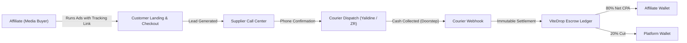

# ViteDrop® — Algerian COD CPA Affiliate Network

> **Production Frontend Application**  
> Built with Next.js 16 (App Router), React 19, TypeScript, Tailwind CSS, Motion, and Vitest.

---

## 1. Overview & Architecture

**ViteDrop** is a specialized Cash-on-Delivery (COD) CPA Affiliate Network engineered specifically for the Algerian e-commerce market. 

Unlike traditional card-processing affiliate platforms or dropshipping tools, ViteDrop operates entirely around **cash settlement at the doorstep**:
* Transactions are executed in physical cash (Algerian Dinars - DZD) upon package handover by courier networks (e.g., Yalidine, ZR Express).
* ViteDrop acts as the immutable tracking engine, prefunded escrow custodian, and dispatch bridge.



---

## 2. Core Ecosystem Roles

| Role | Responsibility | Key Features in UI |
|---|---|---|
| **Affiliate (*Media Buyer*)** | Drives traffic via Facebook/TikTok ads with tracking links (`click_id`, `fbclid`, `ttclid`). | Marketplace catalog, tracking link generator, leads & orders dashboard, wallet & BaridiMob/CCP withdrawal requests, settings. |
| **Supplier (*Fournisseur*)** | Owns physical inventory, funds gross CPA budget in advance, and runs call center operations. | Order queue & 1-click WhatsApp speed dial, product creation studio with solvency invariants, inventory tracking, warehouse logistics, settings. |
| **Admin (*Platform*)** | Supervises platform solvency, resolves disputes, approves payouts, and monitors system health. | Escrow overview, double-entry reconciliation engine, BaridiMob/CCP clearinghouse, order/product supervision, courier webhook monitor, agent manager, audit logs. |
| **Call Center Agent** | Handles inbound customer confirmation calls for suppliers. | Ergonomic speed-dial, phone normalization, call attempt logging, lead status updates. |

---

## 3. Order & Lead State Machine

ViteDrop strictly enforces an 8-stage state machine:

```text
lead_generated       ──> canceled | supplier_confirmed
supplier_confirmed   ──> dispatched
dispatched           ──> in_transit
in_transit           ──> delivered | rto_in_transit
rto_in_transit       ──> returned_to_supplier
canceled             ──> (terminal)
delivered            ──> (terminal - IMMUTABLE)
returned_to_supplier ──> (terminal)
```

> [!IMPORTANT]
> **Anti-Shaving Protection:** The `delivered` state can **only** be triggered by an authenticated courier webhook from Yalidine or ZR Express, never by manual supplier input. Once delivered, delivery settlement is executed and cannot silently transition to RTO or canceled.

---

## 4. Financial Model & Double-Entry Escrow

All financial operations adhere to an immutable double-entry ledger (`wallet_transactions`):

* **The Invisible Spread Model (20% Platform Cut):**
  * When a product is created, the supplier defines the Gross CPA budget (e.g., `1,500 DZD`).
  * On confirmed delivery (`delivered` webhook):
    1. **Debit Supplier:** `SUPPLIER_DEBIT` for Gross CPA (`-1,500 DZD`).
    2. **Credit Affiliate:** `CPA_PAYOUT` for 80% Net Payout (`+1,200 DZD`).
    3. **Credit ViteDrop:** `PLATFORM_FEE` for 20% platform cut (`+300 DZD`).
  * Affiliates only see their net payout; the platform spread is invisible.
* **Return to Origin (RTO / *Retour*):**
  * Affiliate earns `0 DZD`.
  * **Zero Platform Penalty:** ViteDrop operates under a prepaid escrow model where suppliers settle delivery fees directly with their private couriers. **No platform penalty is deducted from the supplier on RTO.**
* **Withdrawals Clearinghouse:**
  * Supported payout rails: **BaridiMob** (20-digit RIP) and **Algérie Poste CCP** (Account + Clé).
  * High-priority threshold: strictly **`20,000 DZD`**, rendered with a glowing amber treatment.
  * Failed or rejected payouts automatically restore affiliate balances via a `WITHDRAWAL_REFUND` ledger transaction.

---

## 5. Algerian Localization & Wilayas

* **58 Wilayas & Communes:** Complete dataset covering codes `01` (Adrar) to `58` (El Meniaa) in [`src/lib/algeria-locations.ts`](file:///C:/Users/adz72/Desktop/vitedrop-frontend/src/lib/algeria-locations.ts).
* **Delivery Intelligence:**
  * *High-Density Zones* (Alger, Oran, Blida, Tipaza, Boumerdès) with 94% home delivery success rate.
  * *Sahara & Remote Hubs* where stop-desk (agency pickup) is automatically recommended to reduce RTO rates.
* **Trilingual Parity:** Seamless switching between French (`fr`), English (`en`), and native Arabic with full Right-to-Left (`dir="rtl"`) layout isolation.

---

## 6. Project Structure

```text
src/
├── app/
│   ├── (public)/          # Landing, login, register, reset password, order tracking
│   ├── admin/             # Platform overview, withdrawals, orders, products, reconciliation, settings
│   ├── affiliate/         # Dashboard, marketplace, links, leads, orders, wallet, settings
│   ├── supplier/          # Queue, call center, orders, products studio, wallet, settings
│   ├── not-found.tsx      # Branded trilingual 404 handler with smart redirection
│   ├── error.tsx          # Client runtime error boundary with soft retry
│   ├── global-error.tsx   # Fatal root layout error boundary
│   └── loading.tsx        # Suspense loading state
├── components/
│   ├── admin/             # Admin headers, reconciliation cards, waybill modals, filters
│   ├── affiliate/         # Tracking link generator, link cards
│   ├── checkout/          # Public COD checkout form with Wilaya/Commune selectors
│   ├── dashboard/         # Shared shell, responsive sidebar, topbar, auth guards
│   ├── supplier/          # Speed-dial cards, top-up modals, solvency pre-check cards
│   └── ui/                # Buttons, cards, modals, tables, badges, selects
├── lib/
│   ├── algeria-locations.ts # 58 Wilayas dataset & delivery intelligence
│   ├── api-client.ts        # Typed API client, JWT parsing, and offline fallbacks
│   ├── formatters.ts        # DZD currency, phone normalization (+213), date helpers
│   └── locales.ts           # Trilingual dictionaries (fr, en, ar)
└── types/                   # Core TypeScript domain models
tests/
├── unit/                  # Vitest unit test suites (locations, formatters, tokens)
└── *.spec.ts              # Playwright E2E suites (185 tests across 35 files)
```

---

## 7. Getting Started

### Prerequisites
* Node.js `20.x` or higher
* npm `10.x` or higher

### Environment Setup
1. Copy the environment template:
   ```bash
   cp .env.example .env.local
   ```
2. Verify endpoints in `.env.local`:
   ```env
   NEXT_PUBLIC_API_URL=http://localhost:4000
   PLAYWRIGHT_BASE_URL=http://localhost:3000
   ```

### Development
Start the Next.js development server:
```bash
npm run dev
```
Open [http://localhost:3000](http://localhost:3000) in your browser.

---

## 8. Verification & Testing

### Unit Tests (Vitest)
Executes isolated tests for pure functions (58 Wilayas mapping, currency formatters, CPA split, phone normalization):
```bash
npm run test:unit
```

### TypeScript Validation
Checks strict type safety across all files:
```bash
npx tsc --noEmit
```

### ESLint Audit
Validates code style and App Router conventions (0 errors):
```bash
npm run lint
```

### End-to-End Tests (Playwright)
Runs the full E2E test suite (185 tests across 35 files):
```bash
npm run test:e2e
```

### Production Build
Builds the optimized production application:
```bash
npm run build
```

---

## 9. CI/CD Pipeline

Continuous Integration is automated via GitHub Actions ([`.github/workflows/ci.yml`](file:///C:/Users/adz72/Desktop/vitedrop-frontend/.github/workflows/ci.yml)), which triggers on pushes and pull requests to `master` to verify:
1. `npx tsc --noEmit`
2. `npm run lint`
3. `npm run test:unit`
4. `npm run build`

---

## 10. License

Private & Proprietary — ViteDrop Network. All rights reserved.
